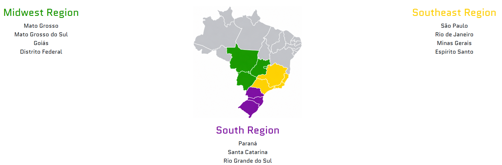
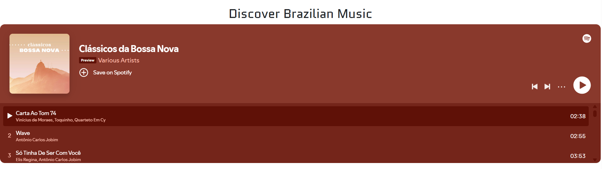

# Visit Brasil 🇧🇷

## Project Overview
Visit Brasil is a website in its first phase of development. It was created for first-time tourists who want to learn more about the country and its different regions.

Brazil is more than just Rio de Janeiro and São Paulo, and this website aims to showcase more of what the country has to offer.
## Target Audience
The target audience includes anyone who has ever wanted to learn more about this beautiful and welcoming country, which is sometimes misunderstood due to its portrayal in the media.
## Features

- **Regional Maps:** 
Color-coded maps designed to help visitors identify Brazil's different regions.
Colour-coded regional headings and state lists that correspond to the map colours, helping visitors identify which states belong to each region.

- **Brazilian Music:** 
An integrated Spotify playlist allowing visitors to explore Brazilian music.

- **Responsive Design:** 
A website designed to adapt to different screen sizes using bootstrap.

## Technologies Used

- HTML5
- CSS3
- Bootstrap
- Git
- GitHub

## Accessibility

Accessibility was taken into consideration during the
development of Visit Brasil to provide a more inclusive
experience for its visitors.

- **Alternative Text:** 
Images include descriptive alt attributes to assist users who rely on screen readers.

- **Semantic HTML:** 
Semantic elements were used to provide a clear and organized website structure.

## Testing
Throughout the development of Visit Brasil, testing
was carried out to identify and resolve issues related
to responsiveness, functionality and website layout.

| Test | Expected Result | Status |
| --- | --- | --- |
| Navigation | All links work correctly | Pass |
| Responsive design | Layout adapts to screen sizes | Pass |
| Spotify player | Playlist loads correctly | Pass |
| HTML validation | No syntax errors | Pass (All pages) |
| CSS validation | No syntax errors | Pass |
| Navigation | All links work corectly | Pass |
| Responsive design | Layout adapts to screen sizes | Pass |
| Spotify player | Playlist loads correctly | Pass |
| Accessibility| Screen readers, keybord navigation, color palet | Pass |

## Bugs encountered and resolved
Header not occupying the full screen width -->	Adjusted CSS and responsive layout.
Regional lists not positioned correctly on smaller screens	--> Adjusted responsive layout and Bootstrap classes.
Spotify heading not displaying -->	Corrected a missing > in the opening section tag.
Regional heading colors not applying --> Corrected CSS heading selectors.

## Deployment

## AI Assistance
### CSS HEADER GRADIENT
-TOOL: CHATGPT
https://chatgpt.com/share/6b05bea8-816c-83e9-84a9-46c4754b83bd

## Credits and References

### Technologies and Resources
- [Bootstrap 5](https://getbootstrap.com/)
- [Google Fonts - Quantico](https://fonts.google.com/specimen/Quantico)

### Images
- Regional maps of Brazil generated using ChatGPT.
- Photographs: [Add original image sources here]

### Content
- [Add sources used for information about Brazil here]

### AI Acknowledgement
ChatGPT was used to support the development process,
including troubleshooting HTML and CSS, understanding
Bootstrap, improving responsive layouts, and generating
regional map illustrations.

## Future Improvements

- Add individual pages for each Brazilian state.
- Expand information about tourist attractions.
- Implement multilingual support.
- Improve interactive features.
- Continue improving website accessibility.
